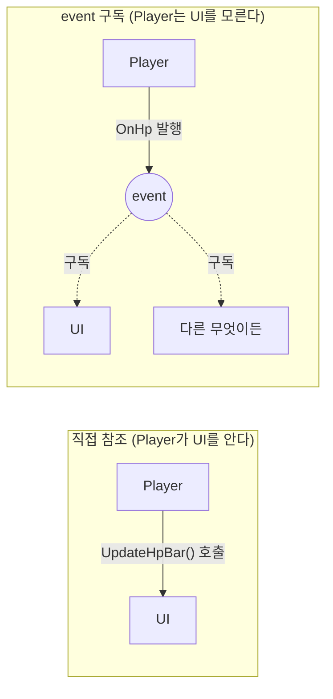

<div align="center">

# C# event로 UI 분리하기

**체력을 아는 쪽은 체력만, 그리는 쪽은 그리기만**

`event Action`으로 Player · Enemy · UI의 의존 방향을 한쪽으로 정리한 연습

[](https://unity.com)
[](https://learn.microsoft.com/dotnet/csharp/)


</div>

---

## 무엇을 한 저장소인가

5주차에 **C#의 `event`를 써서 게임 로직과 UI를 분리**해 본 작은 학습 예제입니다.
스크립트 세 개(`Player` · `Enemy` · `UI`)로 관찰자 패턴의 최소 형태를 만들었습니다.

> [!NOTE]
> 규모가 작은 연습 저장소입니다. 개념을 확인하는 것이 목적이라 게임으로서의 내용은 없습니다.

## 무엇이 문제였나

HP바를 갱신하는 가장 쉬운 방법은 `Player`가 `UI`를 직접 들고 있다가 체력이 바뀔 때마다 부르는 것입니다.
그러면 **`Player`가 `UI`를 알아야 합니다.** UI를 바꾸거나 떼어 내면 `Player`도 같이 고쳐야 하고, 테스트도 어려워집니다.



## 어떻게 바꿨나

### 1. 체력을 가진 쪽은 **알리기만** 한다

`Player`는 누가 듣는지 모릅니다. 값이 바뀌면 그냥 발행합니다.

```csharp
public class Player : MonoBehaviour
{
    public event Action<int, int> OnHp;   // (현재, 최대)
    public event Action Ondie;

    public void TakeDamage(int damage)
    {
        currentHp = Mathf.Max(currentHp - damage, 0);
        OnHp?.Invoke(currentHp, maxHp);    // 구독자가 없어도 안전 (?. 연산자)
        if (currentHp == 0) Ondie?.Invoke();
    }
}
```

### 2. 그리는 쪽은 **구독하고, 반드시 해지**한다

구독만 하고 해지하지 않으면 파괴된 오브젝트가 계속 참조되어 메모리 누수와 예외의 원인이 됩니다.
`OnEnable`에서 걸고 `OnDisable`에서 푸는 것을 쌍으로 맞췄습니다.

```csharp
private void OnEnable()  => player.OnHp += UpdateHpbar;
private void OnDisable() => player.OnHp -= UpdateHpbar;   // ← 이게 빠지면 누수

void UpdateHpbar(int current, int max)
    => fillImage.fillAmount = (float)current / max;
```

### 3. 적은 **인터페이스를 모르고** 때리기만 한다

`TryGetComponent`로 대상이 `Player`일 때만 데미지를 넘깁니다.
`GetComponent` 결과를 `null` 검사하는 방식보다 의도가 분명하고 할당이 없습니다.

```csharp
private void OnTriggerEnter(Collider other)
{
    if (other.gameObject.TryGetComponent(out Player player))
        player.TakeDamage(damage);
}
```

## 배운 것

- **의존 방향을 한쪽으로** — `UI → Player` 한 방향만 남고, `Player`는 UI의 존재를 모른다
- **구독과 해지는 쌍** — `OnEnable` / `OnDisable`에 짝지어 두면 빼먹기 어렵다
- **`?.Invoke()`** — 구독자가 하나도 없을 때의 `NullReferenceException`을 막는다
- **확장이 쉬워진다** — HP바 외에 효과음·화면 연출을 붙일 때 `Player`를 건드릴 필요가 없다

## 실행

```
Unity Hub → Add → week5_Learning 폴더 선택 (Unity 6000.0.55f1)
Assets/Scenes/SampleScene 열고 Play
```

<div align="right"><sub>5주차 학습 예제 · 2026.09.30 ~ 10.01</sub></div>
